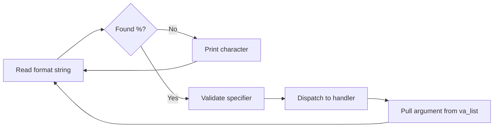

# ft_printf

A reimplementation of C's `printf()` as a static library (`libftprintf.a`), built to understand **variadic functions** and to keep the code clean and easy to extend.

**Stack:** C · `stdarg.h` · `write()` · Make

[:octicons-mark-github-16: View on GitHub](https://github.com/asalazar-z/ft_printf){ .md-button .md-button--primary }

---

## Try it

```c
ft_printf("Hello, %s! You are %d years old.\n", "world", 42);
ft_printf("Pointer address: %p\n", ptr);
ft_printf("Hex: %x / %X\n", 255, 255);
```

It is called exactly like `printf()`, and returns the number of characters printed (or `-1` if a write fails).

## What it supports

=== "Implemented"

    | Specifier | Prints |
    |---|---|
    | `%c` | A single character |
    | `%s` | A string |
    | `%p` | A pointer in hexadecimal |
    | `%d` `%i` | A signed decimal integer |
    | `%u` | An unsigned decimal integer |
    | `%x` `%X` | Hexadecimal, lowercase or uppercase |
    | `%%` | A literal percent sign |

=== "Not implemented"

    Kept out of scope on purpose, to focus on the core mechanics:

    - Internal output buffering (it writes directly with `write()`)
    - Flags: `-` `0` `+` space `#`
    - Field width and precision
    - Length modifiers: `l`, `ll`, `h`, `hh`
    - Other specifiers: `%e` `%f` `%g` `%o` `%n`

## How it works



The format string is parsed one character at a time. When a `%` appears, the next character is checked against the supported specifiers and sent to the matching handler, which takes its argument from the `va_list` and prints it.

## Three ideas worth a closer look

=== "Errors propagate"

    Every output function receives a **pointer to the character counter**.

    If `write()` fails, the counter is set to `-1`. Every later function checks it first and returns immediately, and the main loop stops as soon as it is negative.

    ```mermaid
    flowchart LR
        A["write() fails"] --> B["count = -1"]
        B --> C["Next calls return early"]
        C --> D["Loop stops, returns -1"]
    ```

    No global variables and no scattered error checks: the error state travels with the counter.

=== "Numbers without a buffer"

    Numbers are printed **recursively**: the function goes down to the last digit, then prints on the way back up, so the digits come out in the right order.

    ```text
    print(123)
      └─ print(12)
           └─ print(1)  →  prints "1"
           prints "2"
      prints "3"
    ```

    No temporary array, no extra memory.

=== "One function for both hex cases"

    The digit set is passed in as a parameter, so lowercase and uppercase share the same code:

    ```c
    "0123456789abcdef"   // %x
    "0123456789ABCDEF"   // %X
    ```

    Pointers use a separate function that works on `unsigned long long`, so **64-bit addresses** print correctly on modern systems.

## Design decisions

<div class="grid cards" markdown>

-   :material-source-branch: **Check, then dispatch**

    ---

    Validation (`ft_check_format`) and execution (`ft_get_format`) are separate steps, so adding a new specifier means adding one handler.

-   :material-alert-circle-outline: **Mirrors the original's edge cases**

    ---

    A lone `%` at the end of the format string returns `-1`, matching the undefined behavior of the real `printf()`.

-   :material-puzzle: **Small, focused functions**

    ---

    `ft_putchar_safe`, `ft_putstr_count`, `ft_putnbr_count`... each does one thing and reports its own count.

</div>

## What I learned

!!! note "Key takeaways"
    - How **variadic functions** work, and the lifecycle of a `va_list`.
    - Why an unknown argument type must be handled by the format string, since C can't tell it at runtime.
    - How to design **error handling that scales** through a shared counter.
    - How recursion can replace buffers when output order matters.

## Build it

```bash
git clone git@github.com:asalazar-z/ft_printf.git
cd ft_printf
make                                   # builds libftprintf.a
cc -Wall -Wextra -Werror main.c libftprintf.a
```

| Command | Effect |
|---|---|
| `make clean` | Removes object files |
| `make fclean` | Removes object files and the library |
| `make re` | Rebuilds everything from scratch |
