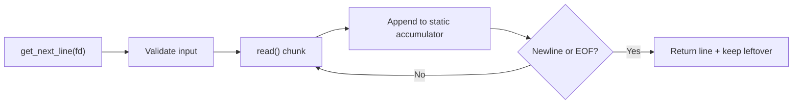

# get_next_line

A C function that reads **one line at a time** from any file descriptor (a file, a pipe, a socket or `stdin`), no matter how large the file or how small the buffer.

**Stack:** C · POSIX `read()` · Heap memory management

[:octicons-mark-github-16: View on GitHub](https://github.com/asalazar-z/get_next_line){ .md-button .md-button--primary }

---

## The idea

```c
int fd = open("story.txt", O_RDONLY);
char *line;

while ((line = get_next_line(fd)) != NULL)
{
    printf("%s", line);
    free(line);
}
```

Each call returns the next line and remembers where it stopped. The challenge is doing that **without leaking a single byte**, whatever `BUFFER_SIZE` the program is compiled with.

## How it works



<div class="grid cards" markdown>

-   :material-shield-check: **1. Input filter**

    ---

    Rejects invalid file descriptors and buffer sizes before any memory is allocated.

-   :material-database-sync: **2. Static accumulator**

    ---

    A `static` pointer keeps unread data between calls, so nothing is lost when a chunk contains more than one line.

-   :material-content-cut: **3. Line extraction**

    ---

    Splits the accumulator at the `\n`, returns the line and stores the remainder, freeing every obsolete block.

</div>

## Why `BUFFER_SIZE` matters

The buffer size is chosen at compile time and changes how the function behaves:

=== "BUFFER_SIZE=1"

    Reads **1 byte at a time**. Very little memory, but hundreds of system calls for a single line.

    :material-speedometer-slow: Slow

=== "BUFFER_SIZE=10"

    Reads in **small chunks**. Whatever doesn't belong to the current line is kept in the static accumulator for the next call.

    :material-speedometer-medium: Balanced

=== "BUFFER_SIZE=10000000"

    Reads **10 MB in one go**. Maximum throughput, but a much bigger memory footprint.

    :material-speedometer: Fast, memory-heavy

If no size is given at compile time, a safeguard in the header defaults it to **42**.

## Mandatory vs. bonus

=== "Mandatory"

    One file descriptor at a time, with a **single static pointer** holding the leftover text.

    ```c
    static char *linetmp;
    ```

=== "Bonus: multiple file descriptors"

    The static pointer becomes an **array indexed by the file descriptor**, so each open file keeps its own state and reading can be interleaved safely.

    ```c
    static char *linetmp[OPEN_MAX];
    ```

    | Call | State used |
    |---|---|
    | `get_next_line(3)` | `linetmp[3]` |
    | `get_next_line(5)` | `linetmp[5]` |
    | `get_next_line(3)` | resumes from `linetmp[3]` |

    No global variables, and no data mixed between files.

## Design decisions

<div class="grid cards" markdown>

-   :material-broom: **"Clean slate" error handling**

    ---

    If `read()` fails, the function frees both the local buffer and that file's static storage, then returns `NULL`. No leaks, no stale state.

-   :material-earth: **Portability first**

    ---

    I avoided zero-byte probes like `read(fd, NULL, 0)`, since their behavior can vary across systems and with non-seekable streams such as pipes.

-   :material-view-module: **Modular design**

    ---

    The logic is split into small functions to respect 42's Norminette limits while keeping each step easy to reason about.

</div>

## What I learned

!!! note "Key takeaways"
    - How **static variables** persist data across function calls.
    - How the **Heap** behaves, and how to keep every allocation accounted for.
    - How `read()` returns data in chunks that rarely line up with line breaks.
    - How to design for failure: closed descriptors, allocation errors and unusual streams.

## Build it

```bash
git clone git@github.com:asalazar-z/get_next_line.git
cd get_next_line

# Mandatory
cc -Wall -Wextra -Werror -D BUFFER_SIZE=10 get_next_line.c get_next_line_utils.c main.c

# Bonus
cc -Wall -Wextra -Werror -D BUFFER_SIZE=42 get_next_line_bonus.c get_next_line_utils_bonus.c main.c
```
