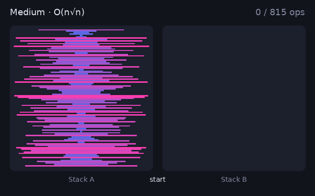
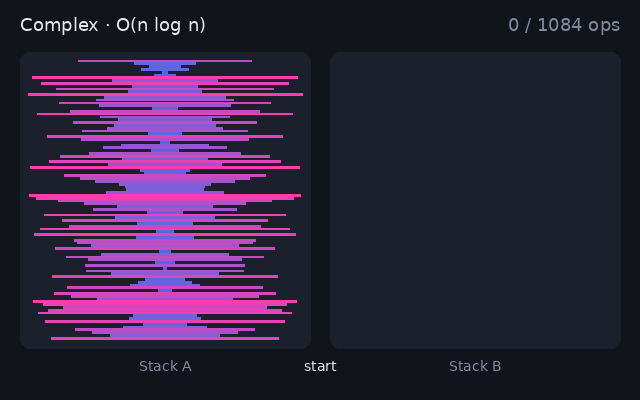
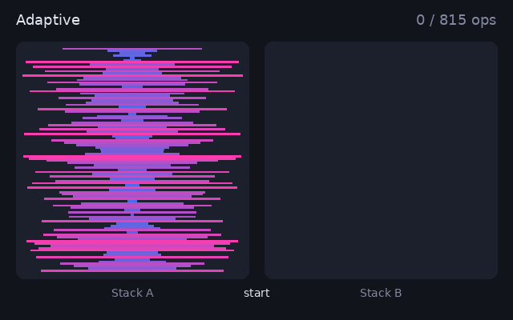
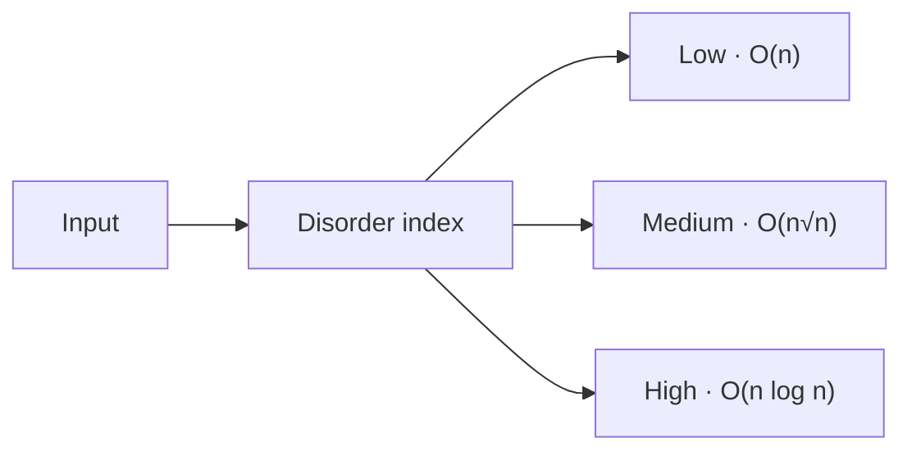

# push_swap

Sort a stack of integers using **two stacks and only 11 operations**, in as few moves as possible. This version implements **four strategies** with different complexity classes, an adaptive mode that picks one based on how disordered the input is, and a checker.

**Stack:** C · Algorithms · Custom libft · Make

[:octicons-mark-github-16: View on GitHub](https://github.com/asalazar-z/push_swap){ .md-button .md-button--primary }

---

## The challenge

You get an unsorted list in **stack A**, an empty **stack B**, and nothing else. No arrays, no `sort()`. Every move must be one of these operations, printed one per line:

=== "Swap"

    | Op | Effect |
    |---|---|
    | `sa` `sb` | Swap the top two elements of A or B |
    | `ss` | `sa` and `sb` at once |

=== "Push"

    | Op | Effect |
    |---|---|
    | `pa` | Move the top of B onto A |
    | `pb` | Move the top of A onto B |

=== "Rotate"

    | Op | Effect |
    |---|---|
    | `ra` `rb` | Shift up: the first element becomes the last |
    | `rr` | `ra` and `rb` at once |

=== "Reverse rotate"

    | Op | Effect |
    |---|---|
    | `rra` `rrb` | Shift down: the last element becomes the first |
    | `rrr` | `rra` and `rrb` at once |

## Watch it sort

Same 100 random numbers, four strategies. Stack A is on the left, stack B on the right, and bar width shows the value.

=== "Simple · O(n²)"

    

    The straightforward approach: efficient on small inputs, but the cost grows quickly with size.

=== "Medium · O(n√n)"

    

    Splits the numbers into **chunks** sized from √n, pushes them to B chunk by chunk, then brings them back in order.

=== "Complex · O(n log n)"

    

    A **radix sort** that works on each element's position in the sorted order (0 to n-1), not on its raw value.

=== "Adaptive"

    

    Measures how disordered the input is and **picks the best strategy automatically**.

## Adaptive mode

The program first computes a **disorder index**: the proportion of inverted pairs in the input. Then it chooses:



Nearly sorted input gets a specialized path that only fixes what is out of place, and very disordered input goes to the radix sort.

## Design decisions

<div class="grid cards" markdown>

-   :material-cube-outline: **One shared `t_parameters` struct**

    ---

    Both stacks, stats, strategy name and flags travel in a single pointer. That kept every function inside 42's four-parameter limit as the shared state grew.

-   :material-memory: **Heap-allocated stack containers**

    ---

    `t_node **` allocated with `malloc`, so operations like `pa` and `ra` can really change which node is on top from inside functions that only receive `params`.

-   :material-rotate-3d-variant: **Cheapest rotation, in one place**

    ---

    `move_to_top` always rotates the shorter way, and every strategy reuses it instead of duplicating that logic.

-   :material-chart-bell-curve: **Chunk size, tested not guessed**

    ---

    The √n chunk formula was checked by sweeping sizes around it on a 500-number input. The computed value was already the local minimum in operations.

</div>

## Findings

!!! note "Things I measured, not just assumed"
    - **Radix cost depends only on `n`.** Sorted, reversed and random inputs of the same size produced the same operation count, because it works on indexes, not on values.
    - **Reusing the general insertion approach was a mistake for nearly sorted input.** It moves every element whatever the order. Looking each target up directly in A and rotating it to the top used far fewer operations when disorder is below 20%.

## Benchmark mode

```bash
./push_swap --bench $ARG > /dev/null
```

Prints to `stderr` the disorder index, the strategy used, its theoretical complexity and a breakdown of every operation performed.

## Bonus: the checker

```bash
./push_swap --complex $ARG | ./checker $ARG
```

It applies the operations to the stack and prints `OK` if A ends up sorted and B empty, `KO` otherwise, or `Error` on invalid input.

## Build and run

```bash
git clone git@github.com:asalazar-z/push_swap.git
cd push_swap
make          # push_swap
make bonus    # checker

./push_swap --simple 5 4 3 2 1
./push_swap "4 67 3 87 23"
```

| Flag | Strategy |
|---|---|
| *(none)* / `--adaptive` | Chooses automatically by disorder index |
| `--simple` | O(n²) |
| `--medium` | O(n√n) |
| `--complex` | O(n log n) |
| `--bench` | Adds metrics on `stderr` |

Invalid input (non-integers, overflow, duplicates) prints `Error` to `stderr`.