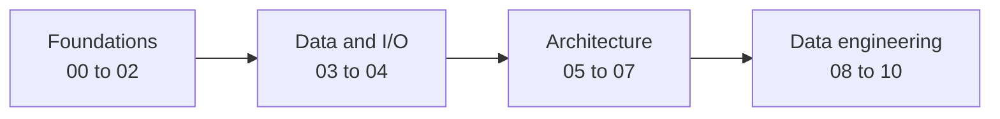

# Python Modules

Eleven modules that take Python from the basics to **data validation, pipelines and functional programming**. Each one is a small project with its own theme, from garden sensors to space stations.

**Stack:** Python · OOP · Pydantic · Virtual environments · Type hints

[:octicons-mark-github-16: View all modules on GitHub](https://github.com/asalazar-z/python-modules){ .md-button .md-button--primary }

---

## The path

## The modules

=== "Foundations"

    From first syntax to code that handles failure.

    | Module | Theme | Concepts |
    |---|---|---|
    | **00 · Growing Code** | Python fundamentals through garden data | Variables, expressions, functions, control flow, type annotations |
    | **01 · Code Cultivation** | Object-oriented garden systems | Classes and objects, inheritance, factory pattern, data analytics |
    | **02 · Garden Guardian** | Resilient pipelines for smart agriculture | Data validation, exception handling, custom error types, resource cleanup |

=== "Data and I/O"

    Working with the structures and files that data lives in.

    | Module | Theme | Concepts |
    |---|---|---|
    | **03 · Data Quest** | Mastering Python collections | Lists, tuples, dicts, sets, comprehensions, generators, command-line arguments |
    | **04 · Data Archivist** | Digital preservation | File operations, data streams, safe archival systems |

=== "Architecture"

    Designing code that is modular and reusable.

    | Module | Theme | Concepts |
    |---|---|---|
    | **05 · Code Nexus** | Polymorphic data streams | Abstract classes, method overriding, subtype polymorphism |
    | **06 · The Codex** | Python's import system | Package initialization, import paths, absolute vs relative imports, circular dependencies |
    | **07 · DataDeck** | Abstract card architecture | Design patterns, interfaces, abstract strategy, modular systems |

=== "Data engineering"

    The tools used in real data projects.

    | Module | Theme | Concepts |
    |---|---|---|
    | **08 · The Matrix** | Real-world data engineering | Virtual environments, package management, environment configuration, a first data pipeline |
    | **09 · Cosmic Data** | Pydantic models and validation | Data models, custom validators, nested structures |
    | **10 · FuncMage** | Functional programming | Lambdas, higher-order functions, decorators |

## Highlights for data engineering

-   :material-shield-check: **Module 09 · Validation**

    ---

    Pydantic models with custom rules and nested data, the same idea behind schema checks in a pipeline.

-   :material-alert-octagon: **Module 02 · Error handling**

    ---

    Custom exceptions and cleanup with `finally`, so a failing sensor doesn't bring down the whole process.

-   :material-package-variant: **Module 08 · Environments**

    ---

    Virtual environments and configuration, the base of reproducible projects.

-   :material-file-document-outline: **Module 04 · Files and streams**

    ---

    Reading, writing and protecting data safely, the first step of any ingestion job.

## What I took away

!!! note "Skills map"
    | Skill | Where it was practiced |
    |---|---|
    | Writing typed, readable Python | 00, 01, 08 |
    | Handling errors and bad data | 02, 09 |
    | Choosing the right data structure | 03 |
    | Reading and writing files safely | 04 |
    | Designing with abstractions and patterns | 05, 07 |
    | Organizing code into packages | 06, 08 |
    | Reusable, higher-order code | 10 |
